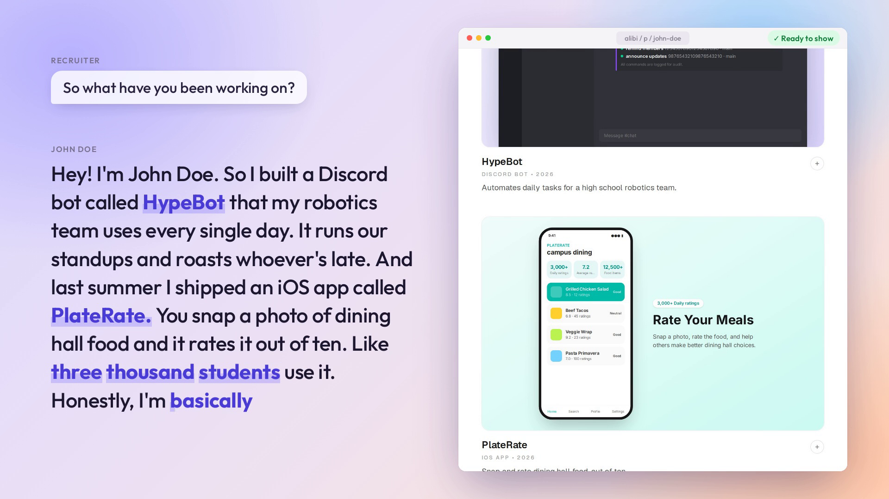

<h1 align="center">Alibi</h1>

<p align="center">
  It builds your "portfolio" while you larp.
</p>

<p align="center">
  
</p>

## About

Alibi is our LarpHacks 2026 project. The prompt was to make something that helps you pretend to be someone you're not, and we took it pretty literally.

Picture a career fair. A recruiter asks about your projects and you start describing apps that don't exist. Alibi is listening the whole time, and as you talk it puts together a personal site with those projects on it. When the conversation gets to "got a link?", you pull out your phone and the site is already up. It's a joke project, but a fun one to build.

## How it works

1. You press the mic and start talking. Speechmatics transcribes the conversation live and tells the speakers apart. Whoever is saying "I built…" is treated as the person larping, so only their projects end up on the site.
2. An LLM (Qwen 2.5 7B on Featherless) picks out your name and each project you mention, along with what kind of product it is.
3. Alibi picks one of our three website templates and fills it in: a bio, then a card for each project with a write-up, stats, tech stack and commit history.
4. Each project also gets a mock screenshot of the "product." We hand-built six layouts (Discord bot, phone app, web dashboard, terminal, chat app and browser extension) and the model fills one in with data that matches what you said.
5. The page updates as each piece is ready, so the site fills in while the conversation is still going.

The model only ever fills in data. It never writes the page itself, so everything stays on-template and a weird sentence in the conversation can't break the site.

## Screenshots

<table>
  <tr>
    <td colspan="2"></td>
  </tr>
  <tr>
    <td colspan="2" align="center">The site finishing up right as the pitch ends</td>
  </tr>
  <tr>
    <td width="38%"></td>
    <td width="62%"></td>
  </tr>
  <tr>
    <td align="center">A finished portfolio</td>
    <td align="center">A few of the mock product screenshots</td>
  </tr>
</table>

## How it actually got built

We started out building on ElevenLabs, but ran into credit issues around the halfway mark, so we moved speech-to-text over to Speechmatics and the LLM calls over to Featherless. That's what it runs on today.

## Running it locally

You'll need Node 20+ and API keys for [Featherless](https://featherless.ai) and [Speechmatics](https://www.speechmatics.com).

```bash
git clone https://github.com/KVS-ALT/Alibi.git && cd Alibi
npm install
cp web/.env.example web/.env.local   # add your two API keys
npm run build:web
npm run start:web                    # http://localhost:3000
```

Open it in Chrome, click the mic and start talking. Something like:

> "Hey! I'm John Doe. So I built a Discord bot called HypeBot that my robotics team uses every single day. And last summer I shipped an iOS app called PlateRate. You snap a photo of dining hall food and it rates it out of ten."

It works best if you say each project's name clearly, say what kind of thing it is ("Discord bot", "iOS app") and throw in a number or two. If a name keeps getting misheard, add it to `SPEECHMATICS_VOCAB` in `web/.env.local`.

Other pages worth a look: `/p/demo-backup` is a finished sample portfolio, `/preview` shows the three templates and `/preview/kits` shows the mock screenshot layouts.

Portfolios live in memory unless you set `DATABASE_URL` to a Postgres database, so links stop working when the server restarts.

## Built with

Next.js · TypeScript · Tailwind · Speechmatics · Featherless · zod

## Team

Built by [Keith Singh](https://github.com/KVS-ALT), Kiranpal Ghandai, Ireoluwa Oluwole and [Harshit](https://github.com/GreenKeewi).

Thanks to Slava Kostrubin and Artin Mehri for organizing LarpHacks.

*Please don't bring this to a real career fair. Every project on our own GitHub is one we actually built.*
