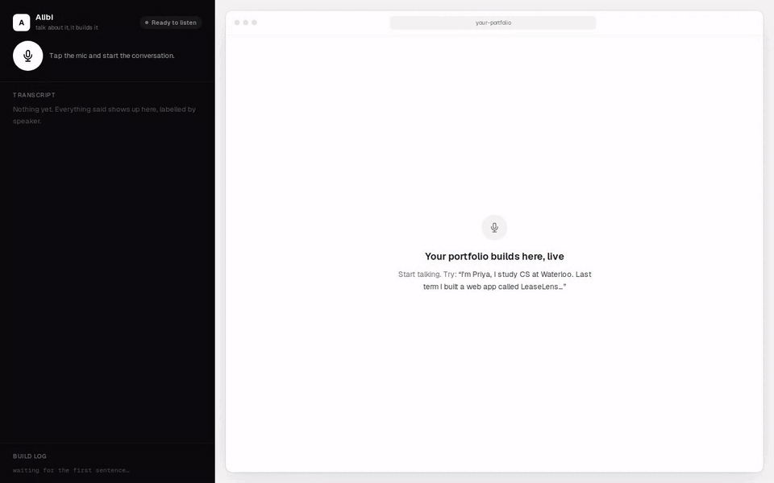
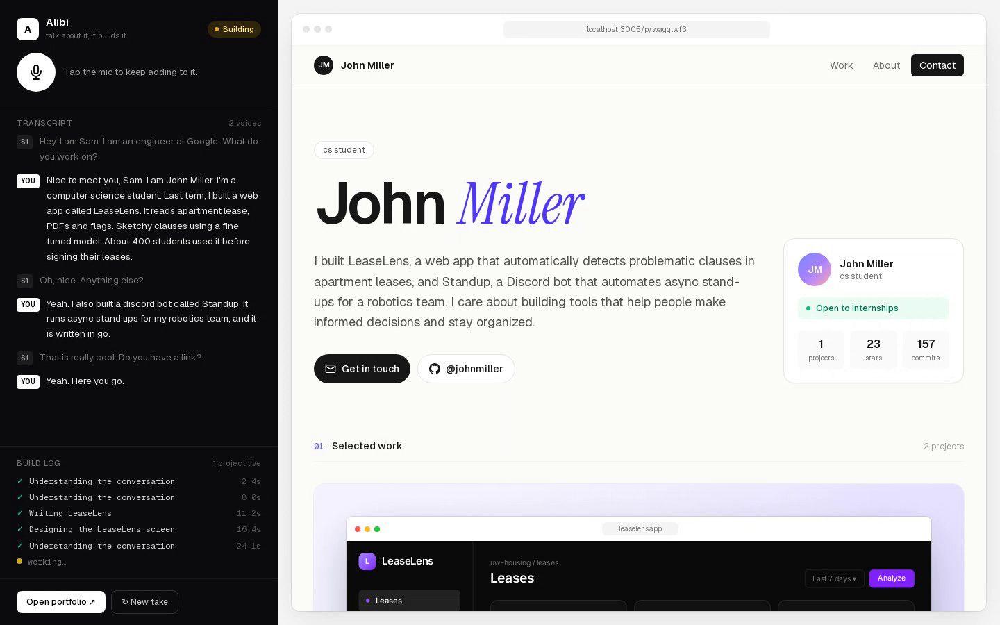
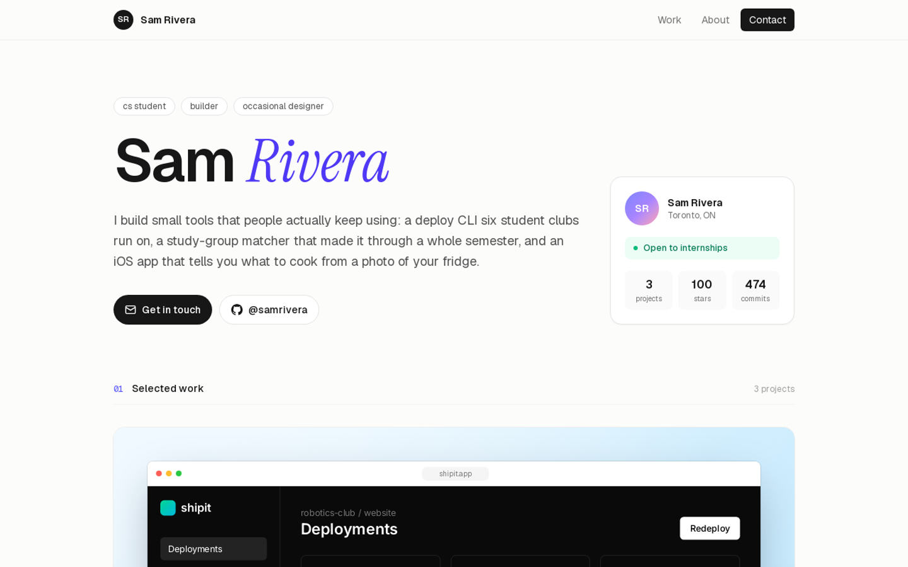
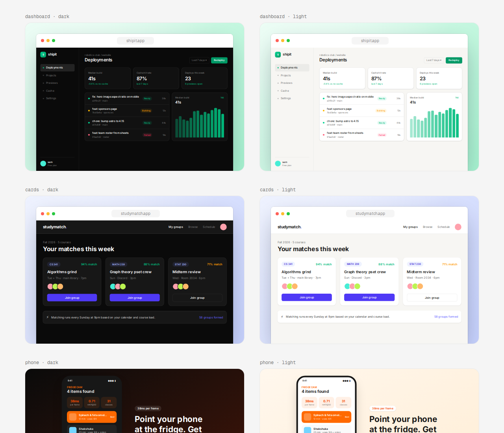

<h1 align="center">Alibi</h1>

<p align="center">
  Make up projects at a networking event, and Alibi builds the portfolio while you're still talking.
</p>

<p align="center">
  
</p>

## About

We built Alibi at LarpHacks 2026, where the theme was "build something that helps you LARP as someone you're not."

Someone asks what you've built, and you make something up. Alibi listens to the conversation, works out which person is doing the bragging, and turns what they say into a portfolio site with project write-ups and product screenshots. By the time they ask for a link, there's one.

## How it works

- **Listening:** Speechmatics transcribes the conversation live and tells the speakers apart. Whoever says "I built…" is treated as the person larping, so only their claims make it onto the site.
- **Writing:** an LLM (Qwen 2.5 7B on Featherless) pulls out the name and projects, then writes each project card. Projects are built in parallel and appear on the page as soon as they're ready.
- **Screenshots:** the product screenshots are six hand-made UI layouts (dashboard, web app, phone app, terminal, Discord bot and browser extension) that the model fills with data. That keeps them clean and believable.

## Screenshots

<table>
  <tr>
    <td width="50%"></td>
    <td width="50%"></td>
  </tr>
  <tr>
    <td align="center">Live transcript, speaker labels and build log</td>
    <td align="center">A finished portfolio</td>
  </tr>
  <tr>
    <td colspan="2"></td>
  </tr>
  <tr>
    <td colspan="2" align="center">Product screenshots for a dev tool, a Discord bot, a phone app and a CLI</td>
  </tr>
</table>

## Running it locally

You'll need Node 20+ and API keys for [Featherless](https://featherless.ai) and [Speechmatics](https://www.speechmatics.com).

```bash
npm install
cp web/.env.example web/.env.local   # add your two API keys
npm run build:web
npm run start:web
```

Open the app in Chrome, click the mic and start talking. For example: *"I'm John, I'm a CS student. Last term I built a web app called LeaseLens that flags sketchy clauses in lease PDFs…"*

## Built with

Next.js · TypeScript · Tailwind · Speechmatics · Featherless · zod

Made by [Keith Singh](https://github.com/KVS-ALT), [GreenKeewi](https://github.com/GreenKeewi), and Claude Code.
